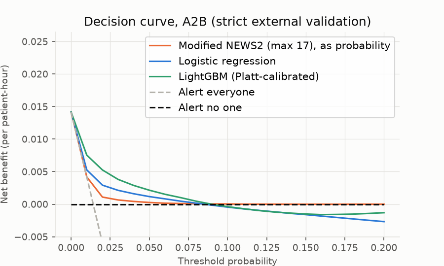
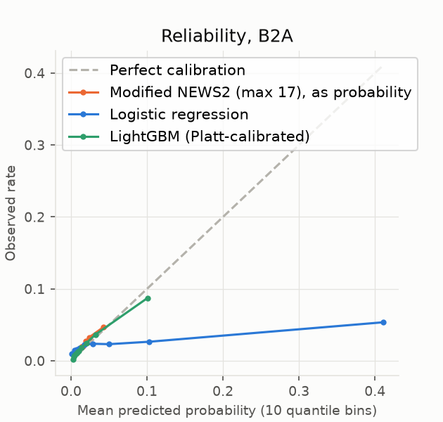
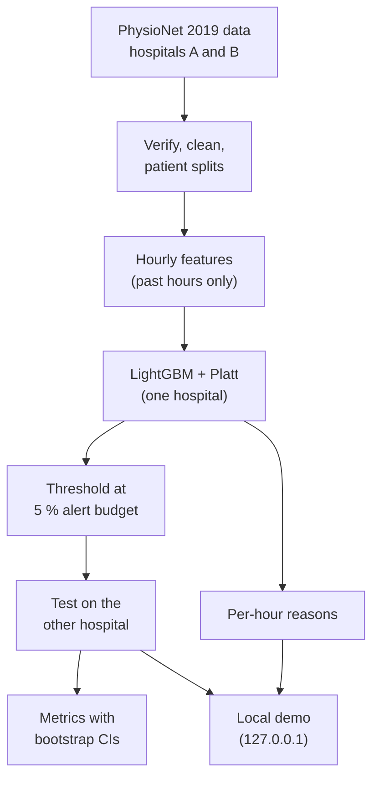

# SepsiScope

**Explainable, alarm-budgeted sepsis early warning, tested on a hospital it never saw.**

SepsiScope predicts sepsis hours before onset from routine ICU data (vital signs, laboratory
values and demographics, hour by hour) in the 40,336 patients of the PhysioNet/CinC
Challenge 2019. A LightGBM model with calibrated probabilities is trained on one hospital
and tested, with its alert threshold unchanged, on the other hospital, under a fixed budget
of alerts in 5 % of patient-hours. Every alert comes with its reasons, and an interactive
demo replays real ICU stays hour by hour next to the bedside NEWS2 score. The evaluation
rules were fixed in advance (the protocol before the data was downloaded), and the whole
analysis re-runs from one command into byte-identical files (result files; see
[Reproducibility](#reproducibility) for the documented exceptions).

> **Research prototype, not for clinical use.**

## Key results

Strict external validation: trained on one hospital, threshold set on that hospital's
validation patients for a 5 % alert budget, then applied unchanged to **every** patient of
the other hospital. 95 % confidence intervals from 1,000 patient-level bootstrap resamples.

| Trained on → tested on | Model | Utility (official) | AUROC | Septic patients warned in time | Alerted patients who are septic | Lift over prevalence |
|---|---|---|---|---|---|---|
| A → B | **SepsiScope (LightGBM)** | **0.226** [0.204, 0.251] | **0.800** [0.790, 0.811] | 40.2 % [37.2, 43.3] | **41.8 %** [38.8, 45.3] | **7.3×** |
| A → B | Logistic regression | 0.186 [0.164, 0.208] | 0.684 [0.668, 0.699] | 39.8 % [36.6, 43.0] | 26.0 % [23.9, 28.1] | 4.6× |
| A → B | Modified NEWS2 | 0.055 [0.043, 0.068] | 0.654 [0.642, 0.666] | 37.1 % [34.1, 40.4] | 12.0 % [11.1, 13.0] | 2.1× |
| B → A | **SepsiScope (LightGBM)** | **0.273** [0.257, 0.290] | **0.765** [0.756, 0.774] | 54.5 % [51.9, 56.8] | **22.8 %** [21.6, 24.0] | **2.6×** |
| B → A | Logistic regression | 0.106 [0.083, 0.127] | 0.641 [0.630, 0.652] | 58.3 % [55.9, 60.7] | 12.5 % [11.9, 13.1] | 1.4× |
| B → A | Modified NEWS2 | 0.061 [0.052, 0.069] | 0.631 [0.621, 0.639] | 41.7 % [39.4, 44.1] | 14.1 % [13.4, 14.8] | 1.6× |

- **Success criterion met in both directions:** the paired utility gain
  over the logistic regression is +0.040 [0.021, 0.059] (A → B) and +0.167
  [0.147, 0.188] (B → A).
- **Alert quality:** an alerting hour is 6.3× (A → B) and 4.4× (B → A) more likely than an
  average hour to carry the dataset's sepsis label (which starts 6 hours before onset).
- **Subgroups and stress tests:** SepsiScope stays ahead of the logistic regression at alert
  budgets of 5 % and 10 % in both directions, and in every sex and age group.
- Utility: the official challenge score (1 = perfect, 0 = never alerting). "Warned in
  time": at least one alert in the 12 hours before onset. Lift: share of alerted patients
  who become septic, divided by the share of all patients who do. In B → A the threshold
  set on hospital B alerts in 8.3 % of hospital A's hours (logistic regression 25.6 %).

Sources: `reports/results/{lgbm,lr,news2}_{A2B,B2A}.json`, `paired_*.json`,
`alert_quality_*.json`, `budgets_*.json`.

**2019 Challenge context.** In the official challenge, the five best teams by full-test
utility scored 0.339 to 0.364 on the full hidden test set and −0.166 to −0.048 on its
hospital C, which no team could train on
([official results](https://moody-challenge.physionet.org/2019/results/), `challenge.tsv`).
SepsiScope's numbers come from a different setting (training on one public hospital and
testing on the other), so they are **not directly comparable**.

**Limitations.** A retrospective study of two US hospitals; how performance varies with
time in the ICU, alarm budgets and hospitals is documented in the
[model card](docs/model_card.md#caveats-and-recommendations).

## Figures

| Decision curve, trained on A → tested on B | Calibration, trained on B → tested on A |
|---|---|
|  |  |

**Demo.** A local web app replays six held-out patients hour by hour: the SepsiScope risk
next to NEWS2, the alert threshold, the early-warning window, the vital signs and, for
every hour, the reasons that raised or lowered the risk. A what-if control shows how alerts
change with the alarm budget, from 1 % to 10 % of hours. It runs locally only, on
`127.0.0.1` (`uv run sepsiscope demo serve`, see below).

## How it works



- **Designed to prevent look-ahead leakage:** patient-level splits, features at hour *t*
  use only hours up to *t*, and no ICU-time or unit columns are used as features.
- **Baselines** from the same pipeline: logistic regression, modified NEWS2, SIRS and qSOFA.
- **Stress tests** (ICU-stay bands, conformal deferral, alarm budgets), ablations and
  threshold drift, all in `reports/results/`.
- **Safe artefacts:** models are LightGBM text plus JSON (never pickle), telemetry is off,
  and a privacy guard checks every commit.

## Quick start

Prerequisites: Python 3.13, [uv](https://docs.astral.sh/uv/) 0.12 and Node 26.
**macOS:** LightGBM also needs the OpenMP runtime `libomp` (for example `brew install libomp`).

```bash
git clone https://github.com/kabir-sinha/sepsiscope.git && cd sepsiscope
```

```bash
uv sync --locked --all-extras
```

```bash
uv run sepsiscope doctor
```

```bash
cd web && npm ci && npm run build && cd ..
```

Run the checks: `uv run pytest`, `uv run ruff check .`, `uv run mypy src`.
Contributors: `uv run pre-commit install` adds the privacy and lint hooks.

## Reproducibility

Download the data once (about 320 MB, into the git-ignored `data/` folder; the only step
that uses the network):

```bash
uv run sepsiscope data download
```

Then one command runs everything else in order (data verification, build and splits,
features, training from the committed tuned parameters, evaluation, ablations, the
stress tests, the alert-quality analysis and the demo data) and stops at the first
failure:

```bash
uv run sepsiscope reproduce
```

About 30 minutes and up to about 6 GiB of memory on a laptop. `--dry-run` lists the steps;
`--retune` repeats the hyperparameter tuning first (about 30 minutes more; a resumed tuning
run is not byte-identical). Then start the demo:

```bash
uv run sepsiscope demo serve
```

**Byte check.** `reports/manifest_c6.json` holds the SHA-256 of every result file (paths
and hashes only). After a re-run, this compares them (only the commit hash inside each
`model.json` is ignored):

```bash
uv run python scripts/byte_check.py --compare reports/manifest_c6.json
```

If a browser's HTTPS-only mode blocks plain-HTTP localhost, open the address in a normal
window.

## Documentation

- [Model card](docs/model_card.md) · [Datasheet](docs/datasheet.md) · [TRIPOD+AI checklist](docs/tripod_ai.md)
- [Evaluation protocol (frozen)](docs/protocol.md) · [Data card](docs/data_card.md) · [EDA findings](docs/eda_findings.md) · [Data manifest](docs/data_manifest.md)
- [Key decisions](docs/decisions/README.md) · [Privacy](docs/privacy.md) · [Traceability](docs/traceability.md) · [Changelog](CHANGELOG.md)

## Citation

If you use SepsiScope, please cite it with [`CITATION.cff`](CITATION.cff) (GitHub's "Cite
this repository" button) and cite the data:

1. Reyna M, et al. Early Prediction of Sepsis from Clinical Data: the PhysioNet/Computing in
   Cardiology Challenge 2019 (version 1.0.0). PhysioNet (2019). doi:10.13026/v64v-d857
2. Reyna MA, et al. Early Prediction of Sepsis From Clinical Data: The PhysioNet/Computing in
   Cardiology Challenge 2019. Critical Care Medicine 2020;48(2):210–217.
   doi:10.1097/CCM.0000000000004145
3. Pollard T, et al. PhysioNet as a global platform for biomedical research. Nature Health
   (2026). doi:10.1038/s44360-026-00096-z

The data (CC BY 4.0) is not included in this repository:
<https://physionet.org/content/challenge-2019/1.0.0/>.

## AI assistance

Development was AI-assisted using Claude Code (Anthropic). Every component was
reviewed, tested and understood by me. Details: [docs/ai_assistance.md](docs/ai_assistance.md).

## Licence

- **Code:** [Apache License 2.0](LICENSE); copyright and attributions in [`NOTICE`](NOTICE)
  (© 2026 SepsiScope contributors). Provided "AS IS", without warranties or conditions of
  any kind (sections 7 and 8); not a medical device.
- **Documentation, figures and result files** (`docs/`, `reports/`, this README):
  [CC BY 4.0](https://creativecommons.org/licenses/by/4.0/).
- **Third-party:** the official PhysioNet scorer in `third_party/physionet_eval/` keeps
  BSD-2-Clause; the IBM Plex fonts keep the SIL Open Font License 1.1.
- **Data:** stays with PhysioNet (PhysioNet/CinC Challenge 2019, CC BY 4.0, cited above);
  it is not included here.

See [ADR 0026](docs/decisions/0026-open-licences.md).
