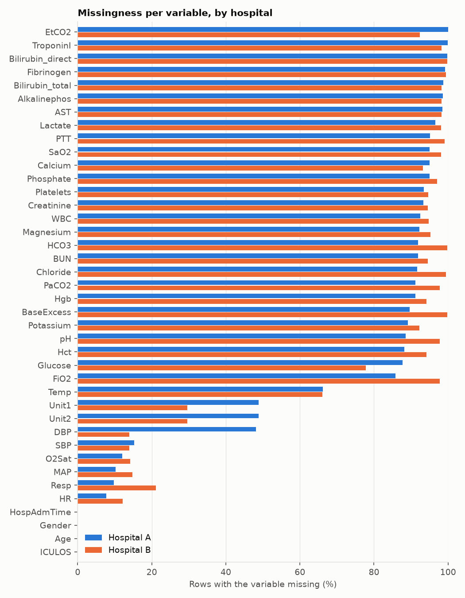
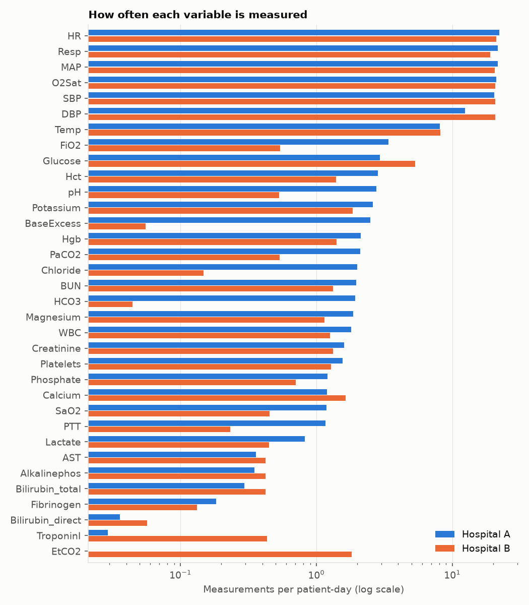
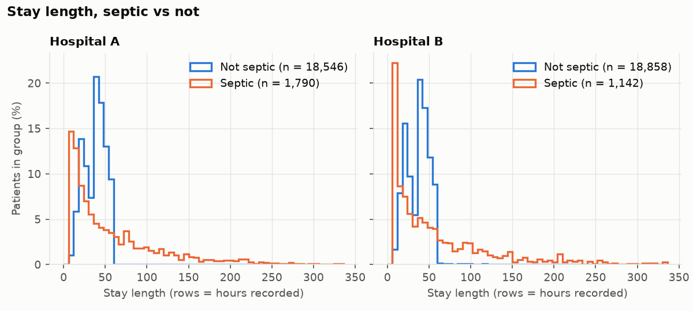
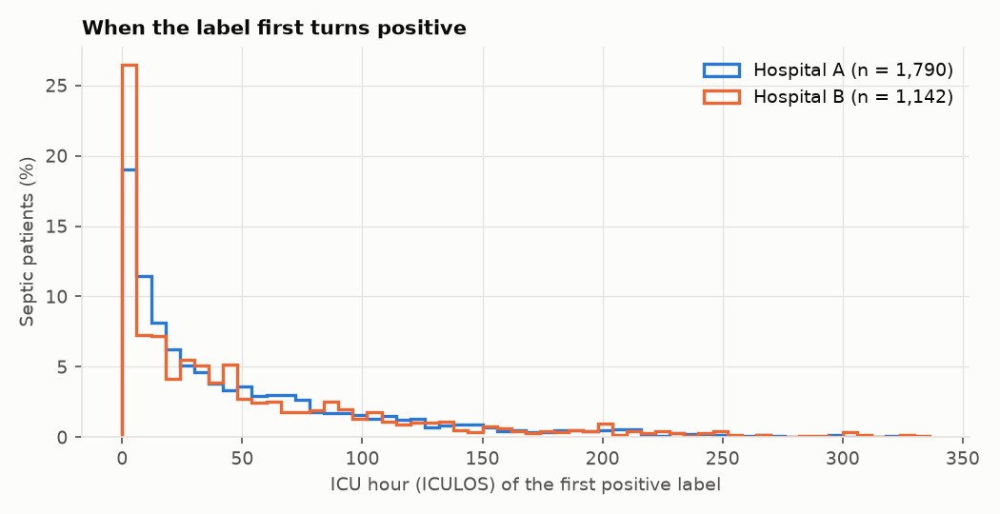
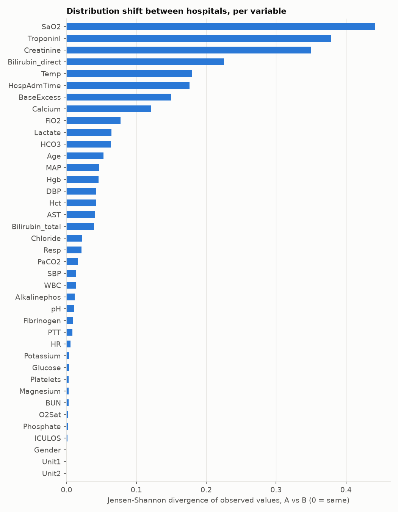
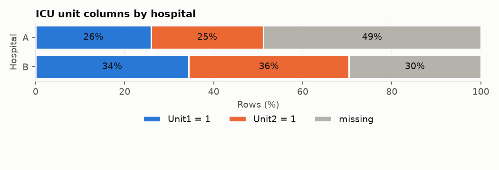

# EDA findings (Phase 1)

Source: `notebooks/01_eda.ipynb`, which only calls `sepsiscope.data.pipeline.run_eda` on the
**clean** table (1,552,210 rows, 40,336 patients). Every number below was produced on
2026-10-10 and can be regenerated with the notebook. No features were engineered and no
model was trained. Colours in the figures: blue = hospital A / not septic, orange =
hospital B / septic.

## 1. The positive class is small, and smaller in B

| | A | B |
|---|---|---|
| Patients | 20,336 | 20,000 |
| Septic patients | 1,790 (8.80 %) | 1,142 (5.71 %) |
| Rows | 790,215 | 761,995 |
| Positive rows | 17,136 (2.17 %) | 10,780 (1.41 %) |
| Median stay (rows) | 39 | 38 |

Overall, 7.27 % of patients are septic but only **1.80 % of rows are positive**. A model
that never alerts is right on 98.2 % of rows, so accuracy is meaningless here; the
protocol's utility score, AUPRC and alarm counts are the right measures. The septic rate
is 1.5 times higher in A than in B, so a threshold tuned in one hospital will not give the
same alert rate in the other.

## 2. Most cells are missing, and missingness differs by hospital

80.1 % of the 34 vital-sign and laboratory cells are missing.

| Group | Share of rows missing (A / B) |
|---|---|
| Most missing: EtCO2 | 100 % / 92.4 % |
| TroponinI | 99.9 % / 98.2 % |
| Bilirubin_direct | 99.9 % / 99.8 % |
| Fibrinogen | 99.2 % / 99.5 % |
| Bilirubin_total | 98.8 % / 98.2 % |
| Alkalinephos | 98.5 % / 98.2 % |
| AST | 98.5 % / 98.3 % |
| Lactate | 96.6 % / 98.1 % |
| PTT | 95.2 % / 99.0 % |
| SaO2 | 95.0 % / 98.1 % |
| … | |
| Temp | 66.2 % / 66.1 % |
| DBP | 48.1 % / 14.0 % |
| SBP | 15.2 % / 13.9 % |
| O2Sat | 12.0 % / 14.1 % |
| MAP | 10.2 % / 14.8 % |
| Resp | 9.8 % / 21.2 % |
| Least missing: HR | 7.7 % / 12.1 % |

Age, Gender and ICULOS are never missing; HospAdmTime is missing in 8 rows. The largest
gaps between hospitals are DBP (34 points), the unit columns (19 points), FiO2 (12),
Resp (11), BaseExcess (10), Glucose (10) and pH (9). **EtCO2 does not exist in hospital A
at all.**

## 3. How often things are measured

Vital signs arrive roughly hourly (HR: 22.1 measurements per patient-day in A, 21.1 in B);
temperature about 8 times a day in both; laboratory values at most a few times a day and
often less than once. Hospital A records blood-gas values far more often than B (FiO2 3.4
vs 0.54 per patient-day, pH 2.8 vs 0.53, BaseExcess 2.5 vs 0.06, HCO3 1.9 vs 0.04), while
B records glucose more often (5.3 vs 2.9) and TroponinI (0.43 vs 0.03). So *whether* and
*how often* a value is measured is itself information, and it is hospital-specific. That
is why the protocol has a "no measurement-process features" ablation.

## 4. Stay length: septic stays are either very short or very long

| | A not septic | A septic | B not septic | B septic |
|---|---|---|---|---|
| Patients | 18,546 | 1,790 | 18,858 | 1,142 |
| Median rows | 39 | 38 | 38 | 37 |
| 25th – 75th percentile | 25 – 47 | 17 – 80 | 23 – 46 | 13 – 82 |
| Mean rows | 36.9 | 58.6 | 36.8 | 59.1 |
| Maximum | 336 | 336 | 336 | 336 |

Medians are almost equal, but the shapes differ: non-septic stays cluster below about
60 rows, while septic stays are spread from 8 to 336. Every stay has at least 8 rows.

## 5. Label timing: many septic patients are positive within hours of arrival

| ICU hour (ICULOS) of the first positive label | A | B |
|---|---|---|
| 25th percentile | 8 | 4.2 |
| Median | 29.5 | 28.5 |
| 75th percentile | 73 | 74 |
| Maximum | 331 | 331 |

426 septic patients (203 in A, 223 in B) are positive from their first row, so no early
warning is possible for them; the protocol reports them separately. **Septic records end
soon after onset:** 1,870 of the 2,932 septic patients have exactly 10 rows from the first
positive row to the end of the record, 795 have 9 and 248 have 8 (19 have fewer). The first
positive row is 6 hours before onset, so a record typically ends 3 hours after onset.

## 6. Distribution shift between hospitals

Jensen-Shannon divergence (base 2; 0 = identical, 1 = no overlap) between A and B, on the
observed values only, using 50 equal-count bins of the pooled data.

| Largest shift | JS | | Smallest shift | JS |
|---|---|---|---|---|
| SaO2 | 0.441 | | Gender | 0.000 |
| TroponinI | 0.379 | | ICULOS | 0.001 |
| Creatinine | 0.350 | | Phosphate | 0.002 |
| Bilirubin_direct | 0.225 | | O2Sat | 0.003 |
| Temp | 0.180 | | BUN | 0.003 |
| HospAdmTime | 0.176 | | Magnesium | 0.003 |
| BaseExcess | 0.149 | | Platelets | 0.003 |
| Calcium | 0.121 | | Glucose | 0.004 |

The core vital signs barely shift (HR 0.006, SBP 0.013, Resp 0.021, MAP 0.047, DBP 0.043),
while several laboratory values and temperature shift a lot. **Caution:** this measure
reacts to how finely a hospital records a value (rounding and decimal places), not only to
real physiological differences, so a high value is a flag to look closer, not proof that
patients differ. EtCO2 has no value because A never records it.

## 7. Unit1 / Unit2: a hospital signal, but a weak one on its own

| Rows | Unit1 = 1 | Unit2 = 1 | Both missing |
|---|---|---|---|
| A | 25.9 % | 25.2 % | 48.9 % |
| B | 34.4 % | 36.0 % | 29.6 % |

The two columns are never both 1 and are always missing together. Their missingness
differs by 19 points between hospitals. Guessing a patient's hospital from "unit missing or
not" alone is right **58.1 %** of the time (against 50.4 % for always guessing A), so the
unit columns leak the hospital only weakly by themselves. `ICULOS` is a stronger marker of
recording practice: it starts at 1 for 93.5 % of B's patients but only 63.1 % of A's, and
the same kind of one-rule guess from it is right 65.0 % of the time (ADR 0015). These
four columns (`Unit1`, `Unit2`, `ICULOS`, `HospAdmTime`) stay out of the main model and
are added back only in an ablation, as the protocol says.

## What this means for Phase 2

1. Use rank- and time-aware metrics (utility, AUPRC, alarms per 100 patient-days); never accuracy.
2. Missingness is the dominant property of the data: features must handle it explicitly
   and causally (only hours up to t).
3. Measurement frequency is informative but hospital-specific: keep the ablation.
4. Expect the alert rate to move between hospitals (different septic rate and recording
   practice): report the realised alert rate next to the budget.
5. Stay length and the position in the stay carry label information because septic
   records are truncated: one more reason to keep `ICULOS` out of the main model.
6. Report the 426 patients positive from row 0 separately.
